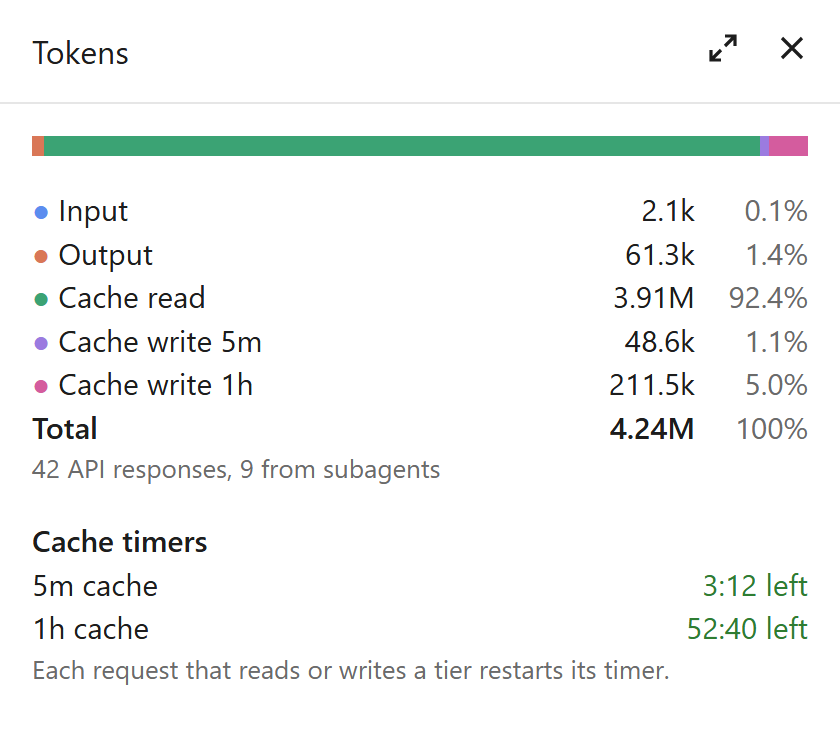
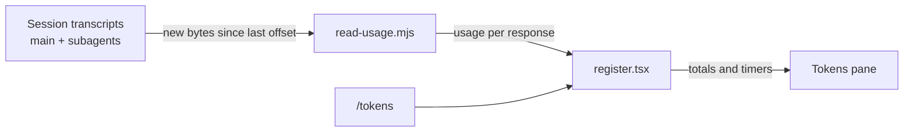

#  Token Distribution

[](https://github.com/naimulnashid/token-distribution/actions/workflows/ci.yml)
[](https://github.com/naimulnashid/token-distribution/releases/latest)
[](LICENSE)

A Claude Code mod that adds a **Tokens** pane beside the chat. It splits the session's tokens into input, output, cache read, cache write 5m and cache write 1h, and counts down how long each prompt cache tier stays warm.

## Screenshots

<picture>
  <source media="(prefers-color-scheme: dark)" srcset="docs/screenshots/pane-dark.png">
  
</picture>

The figures are invented. The image is drawn by `node scripts/make-images.mjs`, which imitates how the Claude desktop app lays out the pane; it is not captured from the app. GitHub shows the dark or light version to match your theme, and the same command redraws both when the pane changes.

## Features

- A stacked bar and a table of the session's tokens by kind: Input, Output, Cache read, Cache write 5m and Cache write 1h, each with its count and share of the total.
- The 5m/1h split of cache writes, which Claude Code's own usage figures do not report, read from the session's transcripts.
- Subagents' requests included, with a count of how many responses came from them.
- A **5m cache** and a **1h cache** countdown: time left, "Expired", or "Not written".
- `/tokens` opens and closes the pane without adding anything to the chat. A pane you close stays closed until you open it again, even when the mod reloads.

## Installation

**Requirements**

- Claude Code with function-hook mods. The mod was built and tested on Claude Code 2.1.309; the mod API is early access and may change between releases.
- Node.js on `PATH`. The mod runs a small Node script to read transcripts. Tested with Node.js 24.18.0; the repository sets no minimum version.
**Install**

At the prompt of a Claude Code terminal session:

```
/plugin install token-distribution --marketplace naimulnashid/token-distribution
```

Answer `y` to add the marketplace, then pick a scope (user scope loads it in every session).

From a shell:

```bash
claude plugin install token-distribution --marketplace naimulnashid/token-distribution
```

In the Claude desktop app, where `/plugin` does not run: click **+** next to the prompt box, then **Plugins**, **Add marketplace** with `naimulnashid/token-distribution`, then **Add plugin**.

There is nothing to download: Claude Code installs the mod straight from this repository. Versions are tagged under [Releases](https://github.com/naimulnashid/token-distribution/releases), with notes on what changed.

## Configuration

No configuration needed. The mod finds the session's transcripts under Claude Code's config folder (`CLAUDE_CONFIG_DIR` when set, otherwise `.claude` in your home folder).

## Usage

- The **Tokens** pane opens when a session starts. In the desktop app it docks beside the chat; in a terminal it docks in fullscreen mode, or sits above the prompt otherwise.
- `/tokens` closes the pane if it is open and opens it if it is closed. It leaves the chat as it was: no reply, and the command's own line is drawn as nothing (the conversation still records it).
- Closing the pane with its X or with `/tokens` keeps it closed for the rest of the session. A new session opens it again.
- The figures cover the whole session, history from before a resume included. After `/clear` they start again from zero.
- A timer restarts each time a request writes that tier or reads the cache while the tier is still alive.

## Tech stack and architecture

- `hooks/register.tsx`: the hooks module. It registers `/tokens`, opens the pane, draws it, keeps the totals and timers in session state, and ticks the countdowns once a second.
- `scripts/read-usage.mjs`: a Node script the module runs. It reads each transcript from the byte offset where the last read stopped and prints the usage of each new API response. The mod cannot do this itself: its own file reads stop at 4 MiB and cannot start mid-file.
- `types/index.d.ts`: the shapes of the values the mod keeps in session state.



Every 3 seconds the module compares the transcripts' sizes, and runs the script only when one has grown. Each response is counted once, though a transcript stores it once per content block.

## Security and privacy

- Everything stays on your computer. The mod reads the session's transcript files locally, runs `node` on its own bundled script, and sends nothing over the network.
- It stores no files. Totals and timers live in the session's state and are rebuilt from the transcripts after a reload.
- It handles no credentials.
- Known limitations: the API does not say which cache tier a read hit, so the timers assume a read restarts every tier still alive. Transcript rows without the 5m/1h split are counted as 5m writes, the API's default lifetime.

There is no SECURITY.md yet. Report a vulnerability through an issue on this repository.

## Development

Run these from the repository's folder, in any shell:

```bash
claude plugin validate .
claude plugin test .
```

`validate` reads the manifest and the hooks module as Claude Code will and lists what they hook and call. `test` runs `tests/pane.test.tsx` against Claude Code's own test kit. CI (`.github/workflows/ci.yml`) runs both on every push to `main` and on pull requests, with the Claude Code version the mod was built against.

To work on the mod live, start Claude Code with `claude --plugin-dir <this folder>`: saving a file reloads the mod. Claude Code writes the API's type declarations into `.claude-plugin/types/` when it loads the mod, and `tsconfig.json` extends them, so type-checking with `tsc -p .` works only after one load. There is no build step.

To redraw the icon's PNG and Windows `.ico` (16 to 256 px) and the screenshots after changing `assets/icon.svg` or the pane's layout (needs Chrome or Edge; set `CHROME` to its executable if it is not found):

```bash
node scripts/make-images.mjs
```

## Contributing, license and support

Open an issue to discuss a change before sending one. There is no CONTRIBUTING.md yet.

Licensed under the MIT License; see [LICENSE](LICENSE).

Issues: <https://github.com/naimulnashid/token-distribution/issues>
